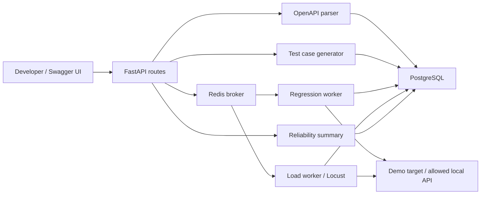
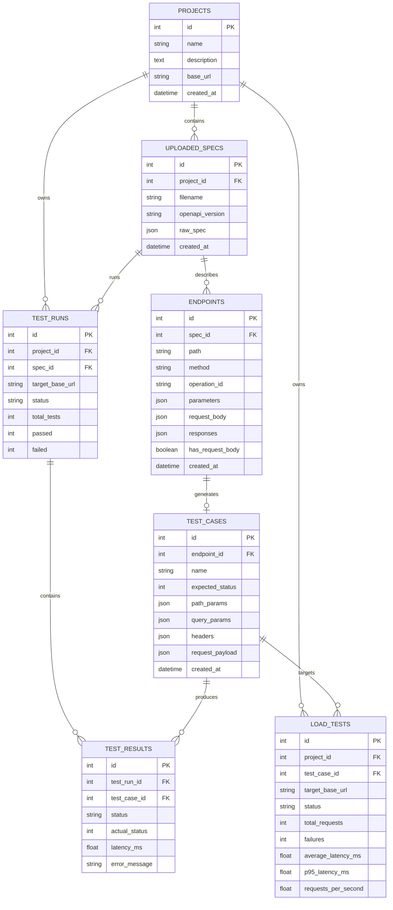
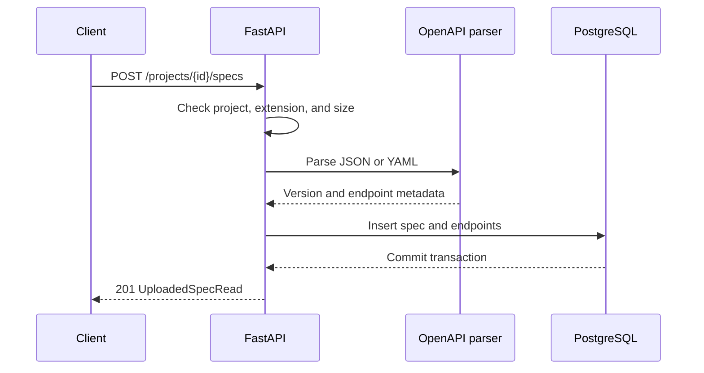

# SpecPulse Architecture

This document describes the local-first architecture and its tradeoffs.

## System Overview

SpecPulse currently runs as a local Docker Compose stack:

## Components

### FastAPI App

The API layer exposes health, project, OpenAPI upload, test-case, and test-run APIs. FastAPI validates route inputs and provides Swagger UI for local demos. Starting a run creates a queued database record, then publishes its ID to Redis.

### OpenAPI Parser

The parser accepts UTF-8 JSON, YAML, and YML files up to 1 MB. It extracts operations from OpenAPI 3.x `paths`, resolves local parameter references, and applies operation-level parameter overrides. It is not a full OpenAPI validator; Path Item references are rejected for now. Parsing happens before any database writes.

### Test Case Generator

The generator makes one draft success case per endpoint. It selects the lowest explicit `2xx` response code (or assumes `200`), fills required path/query/header parameters, and builds basic JSON bodies from examples or required schema properties. Local `$ref` values are resolved. Unsupported schemas fail the whole generation request with `422` and no partial insert. Drafts are generated once per spec; execution requires a separate request.

### Test Runner

The Celery worker claims a queued run, rechecks the configured target allowlist, then calls each case with HTTPX. It records actual status, latency, and errors even when a target request fails. Redirects and environment proxies are disabled. A run moves through `queued`, `running`, and `completed` or `failed`; individual result failures still leave the run `completed` so all cases can be inspected.

### Reliability Summary

The summary reads completed results for the project's current target, grouped by endpoint ID. It shows lifetime failure rate and a rolling window of ten outcomes. The flaky score is the fraction of adjacent outcomes that changed; a flaky verdict also requires at least five results, mixed outcomes, a 10-90% recent failure rate, and two changes. No extra table or migration is needed, so the view cannot drift from stored results. A larger installation would move the aggregation into indexed/windowed queries or a materialized view.

### Load Runner

The API accepts one generated GET case without custom headers and queues a `LoadTest` row. A separate single-concurrency Celery worker consumes the `load-tests` queue so load jobs do not occupy the regression worker. It rechecks the local target allowlist and bounded user, spawn, and duration settings, then runs a static Locust file as a subprocess. Locust's final JSON report is parsed and the summary is stored in PostgreSQL. Only one load job may be queued or running at a time. A failed subprocess or missing report marks the job failed.

### PostgreSQL

PostgreSQL stores projects, uploaded specs, endpoints, generated cases, regression runs/results, and load-test summaries. Reliability summaries are computed from the results on demand.

### Redis

Redis carries Celery tasks from the API to the worker. The local Compose service uses AOF persistence. PostgreSQL remains the source of truth for run status and results; there is no separate Celery result backend.

### Alembic

Alembic manages database schema migrations. M4 adds `test_runs` and `test_results`; M6 adds `load_tests`.

## Current Data Model

## Request Flow: Upload Spec

## Design Choices

- FastAPI gives automatic Swagger docs, which makes demos easy.
- PostgreSQL is used from the start because later reliability and reporting features need relational queries.
- Parsed documents are normalized into JSON so JSON and YAML uploads follow the same storage path.
- Endpoint metadata is stored separately so generation can use normalized operations.
- Execution is opt-in. Mutating methods need another explicit flag, and only configured local hosts may be called.
- Redis queues work; PostgreSQL records the durable outcome. A task claim prevents duplicate execution after a completed run.
- Queue publication and database commit are not atomic; a process failure between them can strand a queued run. See ADR 0005.
- Reliability is a signal based on outcomes, not a diagnosis. Persistent failures and one-time regressions are deliberately not called flaky.
- Load testing is deliberately GET-only and limited to local approved hosts. The separate worker limits interference with regression jobs, but this is not a multi-tenant load-testing service. See ADR 0006.
- Alembic is included early to keep schema changes disciplined.
- The frontend is intentionally deferred. Swagger UI and the repeatable smoke script cover the core demo.

## Verification

`scripts/smoke_demo.py` creates a fresh project, uploads the included specs, generates cases, waits for regression jobs, checks a flaky endpoint after repeated runs, and waits for a Locust summary. It uses returned IDs rather than assuming an empty database. The API healthcheck makes `docker compose up --build --wait -d` wait until migrations and startup finish. The same smoke script runs in the GitHub Actions integration job, alongside the unit-test job.

The full Compose flow has been exercised locally with PostgreSQL, Redis, both Celery workers, and the demo target. A pushed branch's GitHub Actions result and a recorded demo still need separate confirmation. The local setup does not test authentication, remote deployment, queue recovery, or concurrent load-job admission.
