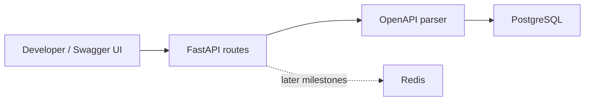
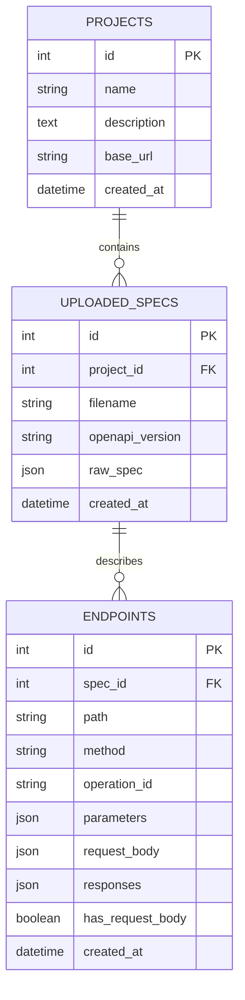
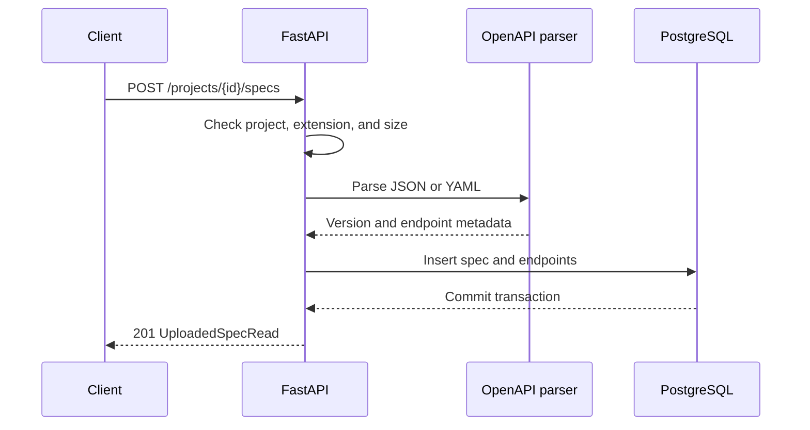

# SpecPulse Architecture

This document describes the current M2 architecture and the planned direction for later milestones.

## System Overview

SpecPulse currently runs as a local Docker Compose stack:

## Components

### FastAPI App

The API layer exposes health, project, OpenAPI upload, spec listing, and parsed endpoint APIs. FastAPI validates route inputs and provides Swagger UI for local demos.

### OpenAPI Parser

The parser accepts UTF-8 JSON, YAML, and YML files up to 1 MB. It supports OpenAPI 3.x documents and extracts operations from the `paths` object. Parsing happens before any database writes, so invalid documents do not leave partial records.

### PostgreSQL

PostgreSQL stores projects, normalized uploaded specifications, and extracted endpoint metadata. Later milestones will add generated test cases, test runs, results, and reliability summaries.

### Redis

Redis is included in M1 so the local environment is ready for M4 Celery workers. It is not used by the current project endpoints yet.

### Alembic

Alembic manages database schema migrations. M2 adds `uploaded_specs` and `endpoints` with foreign keys back to their parent records.

## Current Data Model

## Request Flow: Upload Spec

## Design Choices

- FastAPI gives automatic Swagger docs, which makes demos easy.
- PostgreSQL is used from the start because later reliability and reporting features need relational queries.
- Parsed documents are normalized into JSON so JSON and YAML uploads follow the same storage path.
- Endpoint metadata is stored separately to support querying and later test generation.
- Redis is included early so the development environment is ready for Celery background jobs.
- Alembic is included early to keep schema changes disciplined.
- The frontend is intentionally deferred. Swagger UI is enough for M1 demos.

## Next Architecture Additions

M3:

- Test case model
- Test generator service

M4:

- Celery worker
- Redis-backed async test execution
- Test run and test result models

M5-M7:

- Flaky endpoint detection
- Locust load-test integration
- CI and portfolio polish
