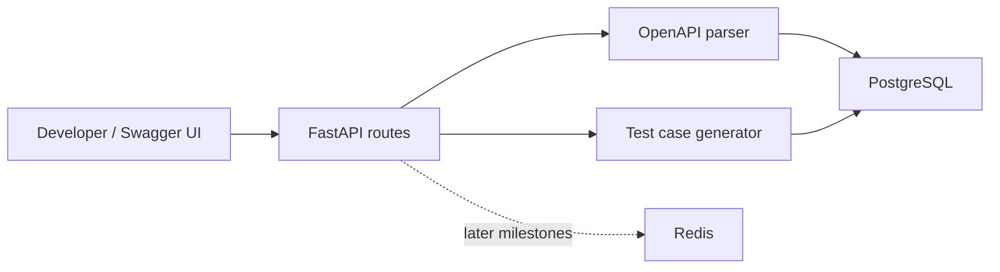
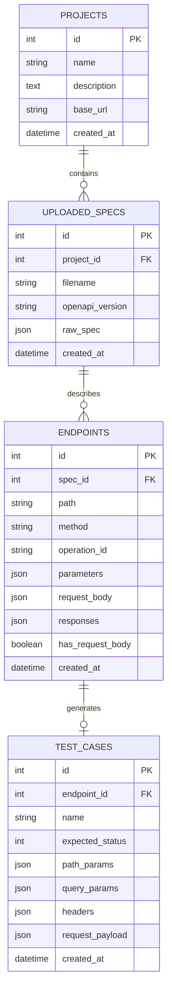
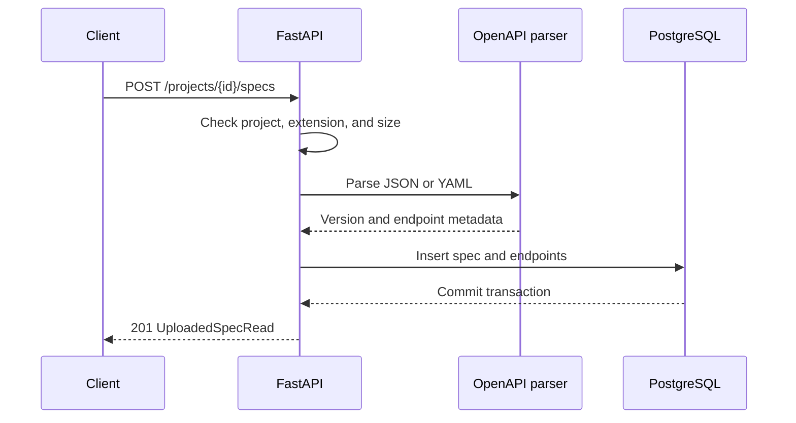

# SpecPulse Architecture

This document describes the current M3 architecture and the planned direction for later milestones.

## System Overview

SpecPulse currently runs as a local Docker Compose stack:

## Components

### FastAPI App

The API layer exposes health, project, OpenAPI upload, spec listing, parsed endpoint, and test-case APIs. FastAPI validates route inputs and provides Swagger UI for local demos.

### OpenAPI Parser

The parser accepts UTF-8 JSON, YAML, and YML files up to 1 MB. It extracts operations from OpenAPI 3.x `paths`, resolves local parameter references, and applies operation-level parameter overrides. It is not a full OpenAPI validator; Path Item references are rejected for now. Parsing happens before any database writes.

### Test Case Generator

The generator makes one draft success case per endpoint. It selects the lowest explicit `2xx` response code (or assumes `200`), fills required path/query/header parameters, and builds basic JSON bodies from examples or required schema properties. Local `$ref` values are resolved. Unsupported schemas fail the whole generation request with `422` and no partial insert. Drafts are generated once per spec and are not executed in M3.

### PostgreSQL

PostgreSQL stores projects, normalized uploaded specifications, extracted endpoint metadata, and generated test cases. Later milestones will add test runs, results, and reliability summaries.

### Redis

Redis is included in M1 so the local environment is ready for M4 Celery workers. It is not used by the current project endpoints yet.

### Alembic

Alembic manages database schema migrations. M2 adds `uploaded_specs` and `endpoints`; M3 adds `test_cases`.

## Current Data Model

## Request Flow: Upload Spec

## Design Choices

- FastAPI gives automatic Swagger docs, which makes demos easy.
- PostgreSQL is used from the start because later reliability and reporting features need relational queries.
- Parsed documents are normalized into JSON so JSON and YAML uploads follow the same storage path.
- Endpoint metadata is stored separately so generation can use normalized operations.
- Generated cases remain drafts. M4 must require an explicit run request and restrict target URLs before sending traffic.
- Redis is included early so the development environment is ready for Celery background jobs.
- Alembic is included early to keep schema changes disciplined.
- The frontend is intentionally deferred. Swagger UI is enough for M1 demos.

## Next Architecture Additions

M4:

- Celery worker
- Redis-backed async test execution
- Test run and test result models

M5-M7:

- Flaky endpoint detection
- Locust load-test integration
- CI and portfolio polish
