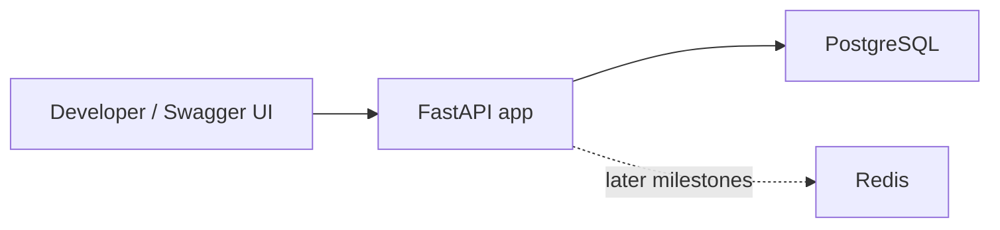
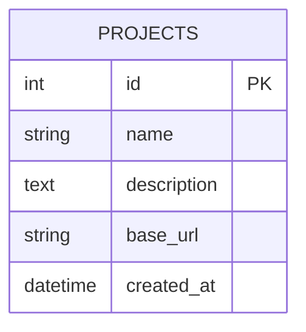
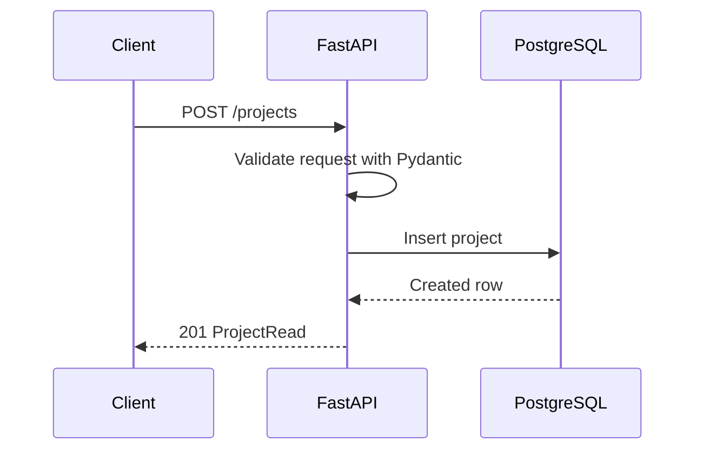

# SpecPulse Architecture

This document describes the current M1 architecture and the planned direction for later milestones.

## M1 System Overview

SpecPulse currently runs as a local Docker Compose stack:

## Components

### FastAPI App

The API layer exposes health and project endpoints. It will later expose OpenAPI upload, test generation, async test-run, reliability, and load-test endpoints.

### PostgreSQL

PostgreSQL stores project metadata in M1. Later milestones will add uploaded specs, parsed endpoints, generated test cases, test runs, test results, and reliability summaries.

### Redis

Redis is included in M1 so the local environment is ready for M4 Celery workers. It is not used by the current project endpoints yet.

### Alembic

Alembic manages database schema migrations. M1 includes an initial migration for the `projects` table.

## Current Data Model

## Request Flow: Create Project

## Design Choices

- FastAPI gives automatic Swagger docs, which makes demos easy.
- PostgreSQL is used from the start because later reliability and reporting features need relational queries.
- Redis is included early so the development environment is ready for Celery background jobs.
- Alembic is included early to keep schema changes disciplined.
- The frontend is intentionally deferred. Swagger UI is enough for M1 demos.

## Next Architecture Additions

M2:

- Uploaded spec model
- Endpoint model
- OpenAPI parser service

M3:

- Test case model
- Test generator service

M4:

- Celery worker
- Redis-backed async test execution
- Test run and test result models

M5-M7:

- Flaky endpoint detection
- Locust load-test integration
- CI and portfolio polish
