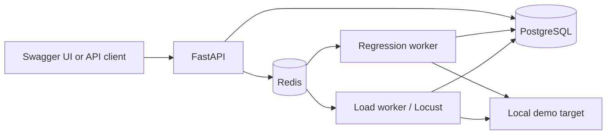

# SpecPulse

SpecPulse turns an OpenAPI spec into repeatable API checks. It generates draft cases, runs them through a background worker, keeps result history, highlights inconsistent endpoints, and can run a small local load test.

The project grew out of API testing work: the interesting problem is how to make a test run reproducible and explain what changed, not how to create another CRUD screen. It is a local-first demo, not a hosted testing service.

## Current Features

- OpenAPI 3.x JSON/YAML upload, endpoint extraction, and stored success-case drafts
- Explicit Celery/Redis test runs with per-case status, latency, and error history
- Reliability summaries over completed runs, with a rolling flaky signal
- Bounded GET-only Locust jobs with stored request, failure, throughput, and latency metrics
- PostgreSQL, SQLAlchemy, Alembic, and a local Docker Compose stack
- Local target allowlist, request timeout, no redirects, and confirmation for mutating methods
- A repeatable demo target, pytest coverage, and GitHub Actions checks

## Architecture



See [ARCHITECTURE.md](ARCHITECTURE.md) and [the decision records](docs/adr) for the data model and tradeoffs.

## Tech Stack

- Python 3.11 or 3.12
- FastAPI
- SQLAlchemy
- Alembic
- PyYAML
- PostgreSQL
- Redis
- Celery
- HTTPX
- Locust
- Docker Compose
- pytest
- Ruff

## Quick Start

Start Docker Desktop, then from this folder:

```powershell
docker compose up --build --wait -d
```

Open:

- API docs: http://localhost:8000/docs
- Health check: http://localhost:8000/health

Run the repeatable end-to-end demo from the host with Python 3.11 or 3.12 and the project environment installed:

```powershell
.\.venv\Scripts\python.exe scripts\smoke_demo.py
```

It creates a new project, uploads both sample specs, waits for Celery regression runs, checks the flaky signal, and waits for a five-second Locust report. It discovers IDs from API responses, so it also works when the database already has data. Stop the stack with `docker compose down`; this keeps the named PostgreSQL and Redis volumes.

The included `.env.example` configures service names and demo credentials for local Compose only. PostgreSQL and Redis are not published on host ports. Do not reuse those credentials outside this disposable setup.

## Try The Project API

Create a project:

```powershell
Invoke-RestMethod `
  -Method Post `
  -Uri http://localhost:8000/projects `
  -ContentType "application/json" `
  -Body '{"name":"Demo API","description":"First SpecPulse project","base_url":"http://demo-target:8001"}'
```

List projects:

```powershell
Invoke-RestMethod -Method Get -Uri http://localhost:8000/projects
```

Upload the included JSON example. The numbered URLs below assume a fresh database where the new project and spec both have ID `1`; use the IDs returned by your API calls otherwise:

```powershell
curl.exe -X POST `
  -F "file=@examples/sample_openapi.json" `
  http://localhost:8000/projects/1/specs
```

List its parsed endpoints, replacing `1` with the returned spec ID:

```powershell
Invoke-RestMethod -Method Get -Uri http://localhost:8000/specs/1/endpoints
```

Generate and inspect draft cases for that spec:

```powershell
Invoke-RestMethod -Method Post -Uri http://localhost:8000/specs/1/test-cases/generate
Invoke-RestMethod -Method Get -Uri http://localhost:8000/specs/1/test-cases
```

Generation is repeatable: calling it again returns the same stored cases. It does not send HTTP requests. The generator handles simple parameter schemas, JSON request bodies, and local schema references. Unsupported inputs return `422` without storing partial cases. If no explicit `2xx` response is defined, the draft assumes `200`; review that value before execution.

Start a run after inspecting the cases. Replace `1` with your project and spec IDs:

```powershell
Invoke-RestMethod `
  -Method Post `
  -Uri http://localhost:8000/projects/1/test-runs `
  -ContentType "application/json" `
  -Body '{"spec_id":1,"confirm_mutating_requests":true}'
```

The response is `202` with a run ID. Check its progress and results:

```powershell
Invoke-RestMethod -Uri http://localhost:8000/test-runs/1
Invoke-RestMethod -Uri http://localhost:8000/test-runs/1/results
```

The included spec has a POST case, so it needs `confirm_mutating_requests=true`. The Docker setup permits only `demo-target` as a destination. Do not point this runner at a production API; generated POST/PUT/PATCH/DELETE requests can change data. The worker checks the allowlist again before execution and does not follow redirects. Runs are limited to 25 cases with a five-second timeout per request.

Compose keeps PostgreSQL and Redis on its internal network, so it will not compete with local services on ports 5432 or 6379.

## Reliability Demo

Upload `examples/flaky_openapi.json` to the same project, generate its case, then start five runs with that spec ID. The local `/flaky` endpoint alternates between `200` and `503`. Check the summary after the runs finish:

```powershell
Invoke-RestMethod -Uri http://localhost:8000/projects/1/reliability
```

Each endpoint has its own history. `failure_rate` covers all completed runs against the project's current target. `recent_failure_rate` and `flaky_score` use at most the last ten results; the score is the fraction of adjacent outcomes that changed. `is_flaky` requires at least five recent results, both passes and failures, a 10-90% recent failure rate, and at least two changes. A persistent failure or one-time regression is not marked flaky. This is a useful signal, not proof of a flaky implementation; target changes and small samples can still mislead.

## Load-Test Demo

Choose the generated **GET** case ID from `GET /specs/1/test-cases`, then start a small local job:

```powershell
Invoke-RestMethod `
  -Method Post `
  -Uri http://localhost:8000/projects/1/load-tests `
  -ContentType "application/json" `
  -Body '{"test_case_id":1,"users":2,"spawn_rate":1,"duration_seconds":10}'
```

The response is `202`. Use its returned ID to inspect the finished summary:

```powershell
Invoke-RestMethod -Uri http://localhost:8000/load-tests/1
Invoke-RestMethod -Uri http://localhost:8000/projects/1/load-tests
```

The separate `load-worker` runs one job at a time. Jobs are restricted to an approved local host, a GET case without custom headers, 1-5 users, and 5-30 seconds. The worker checks the target again before launching Locust. This is for APIs you own, not public or production targets. Locust's final JSON report supplies the request count and latency histogram; requests/sec is the total divided by the configured run duration, and p95 is calculated from Locust's rounded latency buckets.

Example from a local smoke run with one user for five seconds: **13 requests, 0 failures, 0% failures, 2.5 ms average latency, 8 ms p95, 2.6 requests/sec**. Your numbers will differ by machine and target.

## Local Development Without Docker

Use Python **3.11 or 3.12** for local development. The Docker image uses Python 3.12.

Create and activate a virtual environment:

```powershell
py -3.12 -m venv .venv
.\.venv\Scripts\Activate.ps1
python -m pip install --upgrade pip
pip install -e ".[dev]"
```

Run tests:

```powershell
pytest
```

Run lint:

```powershell
ruff check .
```

For local non-Docker API development, you need PostgreSQL, Redis, and matching `DATABASE_URL` and `REDIS_URL`. The default target allowlist is `localhost,127.0.0.1`; Docker uses `RUN_TARGET_HOSTS=demo-target` from `.env.example`. Run migrations and start each worker in its own terminal:

```powershell
alembic upgrade head
celery -A app.worker.celery_app worker --loglevel=info --pool=solo -Q celery
celery -A app.worker.celery_app worker --loglevel=info --pool=solo -Q load-tests
```

## API Endpoints

```text
GET  /health
POST /projects
GET  /projects
GET  /projects/{project_id}
POST /projects/{project_id}/specs
GET  /projects/{project_id}/specs
GET  /specs/{spec_id}/endpoints
POST /specs/{spec_id}/test-cases/generate
GET  /specs/{spec_id}/test-cases
POST /projects/{project_id}/test-runs
GET  /projects/{project_id}/test-runs
GET  /test-runs/{run_id}
GET  /test-runs/{run_id}/results
GET  /projects/{project_id}/reliability
POST /projects/{project_id}/load-tests
GET  /projects/{project_id}/load-tests
GET  /load-tests/{load_test_id}
```

## Verification

`pytest` covers the parser, generation, routes, result storage, reliability rules, queue dispatch, load limits, and Locust report parsing. GitHub Actions runs the unit suite and a separate Compose job that executes `scripts/smoke_demo.py` against PostgreSQL, Redis, and both workers. A passing local run does not imply the pushed GitHub workflow is green; check the Actions tab after pushing.

The bounded load test is intentionally not a benchmark of SpecPulse or your machine. The sample latency numbers above are one local run, not a performance claim. The next polish step is a short screen recording of the smoke run and `/docs` for the repository page.
